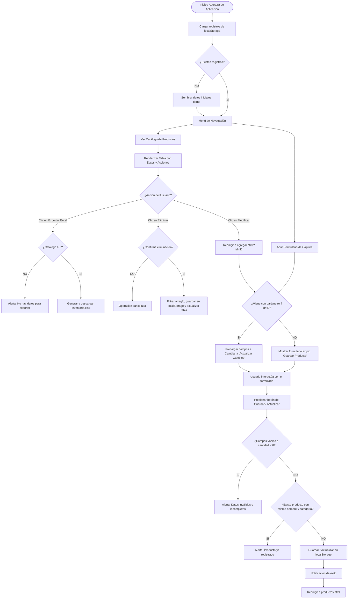

# DOCUMENTACIÓN TÉCNICA Y REPORTE DE PRÁCTICA

**ACTIVIDAD:** PUBLICACIÓN LOCAL Y REMOTA DE UNA APLICACIÓN WEB // ACTUALIZACIÓN INTEGRAL  
**ASIGNATURA:** APLICACIONES WEB  
**CARRERA:** TECNOLOGÍAS DE LA INFORMACIÓN E INNOVACIÓN DIGITAL  
**ALUMNO:** SUÁREZ GONZÁLEZ ABRAHAM  
**PROFESOR:** JOSÉ ALFREDO RAMÍREZ YÁÑEZ  
**SEDE:** JALPAN DE SERRA, QRO.  
**FECHA:** NOVIEMBRE DE 2026  

---

## 1. INTRODUCCIÓN

En el desarrollo de software y sistemas basados en la web, el ciclo de vida de un proyecto no concluye con la escritura del código fuente; una de las etapas más críticas es su puesta en marcha, control de calidad y despliegue. Para garantizar que una solución funcione de forma confiable antes de que sea entregada a los usuarios finales, es indispensable comprender la diferencia operativa entre un entorno de desarrollo local y uno de publicación remota o en producción.

Esta práctica documenta el procedimiento mediante el cual una maqueta web inicial de inventario fue transformada en una **aplicación web interactiva completa (CRUD)**, integrando almacenamiento persistente en el navegador (`localStorage`), validaciones de negocio para casos alternos, rediseño visual profesional en tono azul verdoso (*Teal*), y exportación de reportes a Microsoft Excel (`.xlsx`). 

Asimismo, se aborda el procedimiento de despliegue dual: primeramente en un servidor local mediante **XAMPP / Apache**, validando el comportamiento interno y las rutas en `htdocs`; y posteriormente, su publicación remota en la nube mediante **GitHub** y su servicio de integración continua **GitHub Pages**, obteniendo una URL pública con certificado SSL/HTTPS accesible globalmente.

---

## 2. HERRAMIENTAS UTILIZADAS

* **XAMPP v3.3.0:** Plataforma de servidor local para habilitar y gestionar los servicios de Apache.
* **Git & GitHub:** Sistema de control de versiones distribuido y plataforma en la nube para el repositorio de código fuente.
* **GitHub Pages:** Servicio de alojamiento web estático para el despliegue y publicación continua en producción.
* **HTML5 Semántico:** Estructuración de formularios, tablas interactivas y contenedores modulares.
* **CSS3 Personalizado:** Paleta de diseño corporativo azul verdoso (*Teal*), variables CSS, Flexbox, CSS Grid y microinteracciones de interfaz.
* **JavaScript ES6+:** Programación funcional de lógica CRUD, manipulación del DOM, gestión de eventos y consumo de la API `localStorage`.
* **Biblioteca SheetJS (`xlsx.full.min.js`):** Motor del lado del cliente para convertir arreglos de objetos JSON en libros y hojas de cálculo nativas de Microsoft Excel (`.xlsx`).
* **Navegador Web (Brave / Chrome / Edge):** Entorno de ejecución e inspección de consola, almacenamiento y red.

---

## 3. RESUMEN DE CAMBIOS Y MEJORAS IMPLEMENTADAS

A partir de la maqueta inicial básica que únicamente presentaba datos estáticos y sin interactividad, se implementaron las siguientes mejoras técnicas:

### 3.1. Rediseño Visual Personalizado (UI/UX Moderna)
* **Paleta Teal Corporativa:** Se sustituyeron los colores genéricos por una gama moderna de verde azulado y petróleo (`#0d9488`, `#0e7490`, `#115e59`, `#0f766e`).
* **Tarjetas y Sombras:** Contenedores tipo tarjeta (*cards*) con bordes suaves (`border-radius: 12px`), sombra flotante y fondo de página suave (`#f0fdfa`).
* **Semántica de Botones:** Botones con retroalimentación interactiva al pasar el cursor (`:hover`) diferenciados por color de acción:
  * 💾 Azul verdoso: Guardar y Actualizar producto.
  * ✏️ Ámbar: Modificar registro existente.
  * 🗑️ Carmesí: Eliminar registro.
  * 📊 Esmeralda: Exportar a Excel.

### 3.2. Persistencia Dinámica en `localStorage`
* Se abandonaron los datos fijos en código HTML. Ahora, la aplicación almacena, lee y sincroniza todos los artículos en la memoria del navegador bajo la clave `inventario_ut_db`.
* Si un usuario nuevo ingresa al sistema, un script siembra automáticamente registros demostrativos iniciales. Los cambios persisten incluso si se recarga la página o se cierra el navegador.

### 3.3. Guardado con Gestión de Casos Alternos
El formulario implementa validaciones estrictas previas al almacenamiento:
1. **Caso Alterno 1 (Campos vacíos o espacios):** Se limpian las cadenas con `.trim()`; si faltan campos obligatorios, se bloquea el guardado y se notifica al usuario.
2. **Caso Alterno 2 (Cantidades negativas o no numéricas):** Se exige un valor entero mayor o igual a cero (`min="0"` y validación en JS `cantidad >= 0`), impidiendo existencias negativas.
3. **Caso Alterno 3 (Productos Duplicados):** El sistema verifica si ya existe un artículo con el mismo nombre dentro de la misma categoría. De existir, se emite una alerta impidiendo colisiones en bodega.
4. **Asignación de Clave Única:** Se genera un identificador ID incremental único por artículo.

### 3.4. Funcionalidad de Modificación de Productos
* En la tabla de productos, cada fila contiene un botón **✏️ Modificar** que redirige a `agregar.html?id=[ID]`.
* El formulario lee el parámetro de la URL, localiza el producto en `localStorage`, precarga automáticamente todos sus campos y cambia el encabezado a *"Modificar Producto"* y el botón a *"Actualizar Cambios"*.
* Al guardar, los datos se actualizan in situ en el mismo ID sin generar duplicados.

### 3.5. Funcionalidad de Eliminación Segura
* Cada fila dispone de un botón **🗑️ Eliminar**.
* Para evitar pérdidas accidentales, se dispara una confirmación modal preventiva (`confirm()`) indicando el nombre del producto.
* Al confirmar, se filtra el arreglo de productos, se actualiza el almacenamiento local y la tabla se redibuja en tiempo real.

### 3.6. Exportación a Microsoft Excel (.xlsx) con SheetJS
* Se integró la librería SheetJS en la cabecera de `productos.html`.
* Un botón destacado permite transformar el inventario completo en un archivo `.xlsx` estructurado con títulos en español y fecha en el nombre (`Inventario_Productos_AAAA-MM-DD.xlsx`).

---

## 4. DIAGRAMA DE FLUJO DEL SISTEMA

---

## 5. MANUAL DE USUARIO

### 1. Acceso a la Plataforma
* **Acceso Local (Servidor XAMPP):** Asegúrate de que el módulo Apache esté en estado *Running* en XAMPP Control Panel y escribe en tu navegador:  
  `http://localhost/inventario-web/`
* **Acceso en Producción (Internet):** Ingresa directamente desde cualquier computadora o celular a la URL pública:  
  `https://blitzxx-tech.github.io/inventario-web/`

### 2. Navegación Principal
En la parte superior encontrarás la barra de menú con tres opciones:
* **Inicio:** Presentación de la plataforma e información general.
* **Productos:** Tabla general de existencias, control de stock y descargas.
* **Agregar Producto:** Formulario de alta y edición de artículos.

### 3. Consulta de Inventario
En la sección **Productos** se despliega una tabla con las siguientes columnas:
* **ID:** Código numérico correlativo asignado por el sistema.
* **Producto:** Nombre comercial del artículo.
* **Categoría:** Departamento clasificador (Papelería, Cómputo, etc.).
* **Descripción:** Especificaciones y notas del producto.
* **Existencia:** Cantidad física disponible.
* **Acciones:** Botones interactivos para editar o dar de baja.

### 4. Registro de Nuevos Artículos
1. Haz clic en la pestaña **Agregar Producto**.
2. Completa los campos:
   * **Nombre del producto (*):** Nombre descriptivo.
   * **Categoría (*):** Departamento al que pertenece.
   * **Descripción:** Características complementarias (opcional).
   * **Cantidad en existencia (*):** Debe ser 0 o un entero positivo.
3. Haz clic en el botón verde azulado **Guardar Producto**.
4. El sistema validará la información y te redirigirá a la tabla donde verás el nuevo registro inmediatamente.

### 5. Modificación de Artículos
1. En la tabla de productos, haz clic en el botón amarillo **✏️ Modificar** del artículo deseado.
2. El formulario se abrirá automáticamente con toda la información cargada.
3. Modifica los valores que requieras (ej. aumentar la cantidad por nueva llegada de mercancía).
4. Haz clic en **Actualizar Cambios**. El registro quedará actualizado al instante.

### 6. Eliminación de Artículos
1. En la tabla, pulsa el botón rojo **🗑️ Eliminar** del artículo a dar de baja.
2. Confirma en el cuadro de diálogo emergente haciendo clic en **Aceptar**.
3. El producto se eliminará de inmediato de la memoria y la tabla se refrescará.

### 7. Exportación del Reporte a Excel
1. En la vista **Productos**, pulsa el botón verde **📊 Exportar a Excel (.xlsx)**.
2. El archivo se generará y descargará automáticamente con el nombre `Inventario_Productos_AAAA-MM-DD.xlsx`.
3. Ábrelo en Microsoft Excel o Google Sheets para consulta, impresión o auditorías.

---

## 6. GESTIÓN DEL TIEMPO (CRONOGRAMA DE ACTIVIDADES)

| Fase del Proyecto | Actividades Principales Desarrolladas | Tiempo Estimado | Tiempo Real | Estado / Cumplimiento |
| :--- | :--- | :---: | :---: | :---: |
| **Fase 1: Análisis y Requerimientos** | Análisis de la maqueta previa, definición del alcance del CRUD, validaciones y diseño. | 2.0 hrs | 2.0 hrs | 100% Completado |
| **Fase 2: Entorno Local y Versionado** | Activación de XAMPP / Apache, configuración en `htdocs`, inicialización de Git y repositorio remoto. | 2.5 hrs | 3.0 hrs | 100% Completado |
| **Fase 3: Rediseño Visual UI/UX** | Maquetación con CSS3, desarrollo del tema corporativo azul verdoso (*Teal*), tarjetas y botones. | 3.0 hrs | 3.5 hrs | 100% Completado |
| **Fase 4: Lógica CRUD y Validaciones** | Programación JavaScript, integración de `localStorage`, control de casos alternos, edición y baja. | 4.5 hrs | 5.0 hrs | 100% Completado |
| **Fase 5: Módulo de Reportes Excel** | Integración del script CDN SheetJS, mapeo de datos y exportación a archivos `.xlsx`. | 1.5 hrs | 1.5 hrs | 100% Completado |
| **Fase 6: Pruebas y Despliegue** | Ejecución de casos de prueba, resolución de casos borde, commits y despliegue en GitHub Pages. | 2.0 hrs | 2.5 hrs | 100% Completado |
| **Fase 7: Documentación Técnica** | Redacción del reporte, manual de usuario, diagramas de flujo y consolidación de evidencias. | 3.0 hrs | 3.0 hrs | 100% Completado |
| **TOTAL ACUMULADO** | **Esfuerzo global invertido en el ciclo completo de la aplicación** | **18.5 hrs** | **20.5 hrs** | **100% Exitoso** |

---

## 7. MATRIZ DE PRUEBAS FUNCIONALES Y CASOS ALTERNOS

| ID | Caso de Prueba | Comportamiento Esperado | Resultado |
| :---: | :--- | :--- | :---: |
| **CP-01** | Carga de página principal (`index.html`) | Despliegue correcto de encabezado teal, menú y presentación. | **Correcto** |
| **CP-02** | Navegación entre pestañas | Cambio ágil entre vistas sin enlaces rotos ni desajustes visuales. | **Correcto** |
| **CP-03** | Visualización de tabla de inventario | Despliegue de registros tabulados con sus seis columnas correspondientes. | **Correcto** |
| **CP-04** | Apertura de formulario de registro | Formulario limpio con campos habilitados y botón de guardado. | **Correcto** |
| **CP-05** | Registro exitoso de nuevo artículo | Inserción en memoria local, generación de ID y redirección al catálogo. | **Correcto** |
| **CP-06** | *Caso alterno:* Envío de campos vacíos | Bloqueo de envío y mensaje: "Por favor llena los campos requeridos". | **Correcto** |
| **CP-07** | *Caso alterno:* Cantidad negativa (-10) | Detección de valor negativo y bloqueo con aviso de número válido. | **Correcto** |
| **CP-08** | *Caso alterno:* Producto duplicado | Alerta al detectar coincidencia exacta de nombre y categoría en catálogo. | **Correcto** |
| **CP-09** | Carga en modo modificación | Al pulsar "Modificar", precarga los datos y cambia a "Actualizar Cambios". | **Correcto** |
| **CP-10** | Actualización de producto | Guarda los campos modificados manteniendo el mismo ID original. | **Correcto** |
| **CP-11** | *Caso alterno:* Cancelar eliminación | Al hacer clic en "Cancelar" en la ventana de confirmación, los datos se preservan. | **Correcto** |
| **CP-12** | Eliminación confirmada de producto | Al aceptar la confirmación, el registro desaparece y la tabla se actualiza. | **Correcto** |
| **CP-13** | Exportación de reporte a Excel (.xlsx) | Generación y descarga inmediata del archivo de cálculo con datos reales. | **Correcto** |
| **CP-14** | Persistencia tras recargar (F5) | Los cambios persisten sin alterarse al cerrar o refrescar el navegador. | **Correcto** |
| **CP-15** | Acceso y ejecución remota | Operación idéntica y sin fallas desde la URL de GitHub Pages en Internet. | **Correcto** |

---

## 8. URL PÚBLICA DEL PROYECTO

🌐 **Enlace oficial de producción:**  
[https://blitzxx-tech.github.io/inventario-web/](https://blitzxx-tech.github.io/inventario-web/)

---

## 9. CONCLUSIÓN

La realización de esta práctica representó una experiencia integral de desarrollo y despliegue web, abarcando desde la concepción del código hasta su distribución en entornos de producción. El proyecto evolucionó exitosamente de una maqueta estática básica hacia un sistema interactivo de gestión de inventarios, aplicando principios de persistencia en cliente, ergonomía visual y exportación ofimática.

En el aspecto operativo, el despliegue dual contrastó las características de un entorno local frente a uno en la nube. Con **XAMPP / Apache** se consolidó el entendimiento del protocolo HTTP, la jerarquía de rutas del servidor y el ciclo de depuración local sin dependencia de red. Posteriormente, con **Git y GitHub Pages** se experimentó la automatización de flujos de integración y entrega continua (CI/CD), donde los cambios confirmados en la rama principal se compilan y distribuyen automáticamente en servidores mundiales bajo protocolo seguro HTTPS.

En el aspecto lógico, la adopción de `localStorage` permitió demostrar que es viable desarrollar aplicaciones rápidas y desacopladas en el Front-End para prototipos ágiles y proyectos departamentales, evitando costos de infraestructura de bases de datos centralizadas en fases tempranas. La rigurosa incorporación de validaciones para casos alternos (bloqueo de duplicados, cantidades negativas y campos vacíos) reforzó el criterio de ingeniería de software, demostrando que la solidez de una aplicación depende de anticipar las fallas operativas del usuario final.

Finalmente, el rediseño gráfico en tonos azul verdoso (*Teal*) y la incorporación del reporte descargable a Microsoft Excel con SheetJS elevaron la calidad del producto, transformándolo en una herramienta de utilidad práctica y estética profesional.
